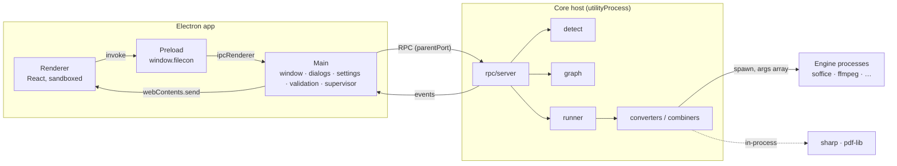
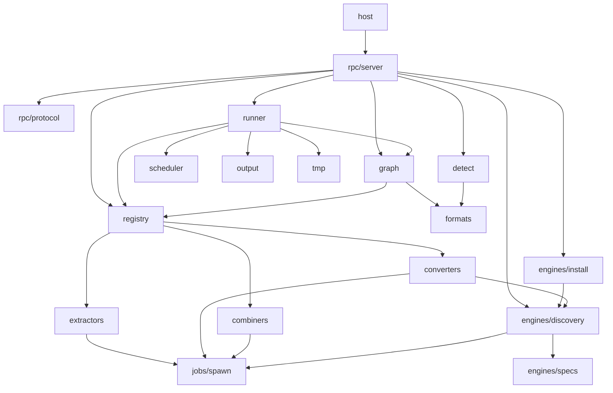

# fileCon — Architecture

Status: draft v1 · Related: [Contracts](CONTRACTS.md) · [Flows](FLOWS.md) · [Build plan](BUILD-PLAN.md) · [TRD](TRD.md) · [Index](INDEX.md)

This doc explains **how the system is structured and how its algorithms work**. Type definitions live only in [CONTRACTS](CONTRACTS.md). Step-by-step interactions live in [FLOWS](FLOWS.md).

## 1. Overview

fileCon is an **orchestrator**. It detects formats, plans routes through a graph of converter edges and runs jobs. Engines (libvips, LibreOffice, FFmpeg…) do the actual format work.



## 2. Processes

| Process | Owns | Must never |
|---|---|---|
| **Renderer** | UI state, user intent, rendering | Touch `fs`, spawn anything, see Node APIs. It gets paths only from drop (`webUtils`) or dialogs |
| **Preload** | The typed `window.filecon` bridge ([CONTRACTS section 7](CONTRACTS.md#7-ipc-renderer--main)) | Contain logic beyond forwarding |
| **Main** | Window lifecycle, single-instance lock, native dialogs, `settings.json`, path validation, folder expansion, `shell:reveal`, the core supervisor, the log file | Run conversions, load engines, or block for more than a few ms |
| **Core host** | Detection, graph, planning, scheduling, temp dirs, output commit, engine discovery, in-process engines (sharp, pdf-lib) | Import `electron`, or trust paths without re-checking that they exist |
| **Engine process** | One conversion step | Write outside its step `outDir`. That's enforced by args and cwd, not by trust |

The core host is a plain Node entry (`core/src/host.ts`). Electron starts it with `utilityProcess.fork`. A Tauri build would start the same code as a Node sidecar, using the same protocol over stdio ([ADR-13](#15-adr-log)).

## 3. Repo layout

```
fileCon/
├── packages/
│   ├── core/src/
│   │   ├── host.ts               utilityProcess / sidecar entry: wires transport → rpc/server
│   │   ├── types/                zod schemas and types for CONTRACTS, one file per section + index.ts
│   │   ├── errors.ts             coreError() + CoreFailure (what core throws): code + params, no prose
│   │   ├── formats.ts            FormatInfo table, aliases, ext → format lookup
│   │   ├── detect.ts             content + extension detection
│   │   ├── registry.ts           register / list converters and combiners
│   │   ├── graph/
│   │   │   ├── build.ts          nodes and edges, same-pair dedupe
│   │   │   ├── route.ts          route search and its per-source cache
│   │   │   ├── targets.ts        convert, merge and extract options for a set of inputs
│   │   │   └── index.ts          public API
│   │   ├── jobs/
│   │   │   ├── runner.ts         job lifecycle, convert and merge flows, cleanup
│   │   │   ├── steps.ts          one step: scheduler slot, size-scaled timeout, output check, fan-out
│   │   │   ├── combine.ts        a combiner run with the same scaled timeout
│   │   │   ├── plan.ts           re-detect an input, route it (ENGINE_MISSING vs NO_ROUTE)
│   │   │   ├── progress.ts       throttled updates, never-backwards fraction, notes
│   │   │   ├── scheduler.ts      FIFO queue, global slots, per-converter semaphores
│   │   │   ├── output.ts         name reservation, exclusive commit, multi-output folder
│   │   │   ├── spawn.ts          safe spawn: args array, timeout, abort, tree kill, stderr tail
│   │   │   └── tmp.ts            mkdtemp, recursive remove, startup sweep
│   │   ├── engines/
│   │   │   ├── specs.ts          EngineSpec per engine (the only per-OS data)
│   │   │   ├── discovery.ts      override → installed → PATH → known paths, version probe
│   │   │   └── install.ts        download → verify SHA-256 → unpack → re-discover
│   │   ├── rpc/
│   │   │   ├── protocol.ts       envelope guards, method/event names
│   │   │   └── server.ts         dispatch methods → modules, emit events
│   │   ├── converters/           sharp.ts · pdflib.ts · libreoffice.ts · poppler.ts · …
│   │   ├── combiners/            merge-pdf.ts
│   │   ├── extractors/           pdfimages.ts
│   │   └── pages.ts              parse / normalize / bound-check the `pages` option
│   ├── core/test/                tests mirroring src/ (jobs/output.test.ts), plus contract.ts, fakes.ts
│   ├── app/src/
│   │   ├── main/
│   │   │   ├── index.ts          app lifecycle, window, wiring
│   │   │   ├── supervisor.ts     fork core host, restart with backoff, CoreStatus
│   │   │   ├── coreClient.ts     RPC client: ids, pending map, event fan-out
│   │   │   ├── ipc.ts            ipcMain handlers (CONTRACTS section 7)
│   │   │   ├── paths.ts          path validation, folder expansion
│   │   │   ├── settings.ts       load / validate / atomic save
│   │   │   └── log.ts            rotating log file in userData/logs
│   │   ├── shared/i18n.ts        translate(key, params) for main and renderer (CONTRACTS section 10)
│   │   ├── locales/en.json       every user-facing English string, flat keys
│   │   ├── preload/index.ts      contextBridge → window.filecon
│   │   └── renderer/
│   │       ├── theme/            tokens.ts (light/dark × accent), applied as CSS variables
│   │       ├── store/            reducer, actions, selectors, useCoreEvents
│   │       ├── components/       DropZone, FileList, TargetPicker, OptionsBar, JobsPanel, …
│   │       └── pages/            ConvertPage, EnginesPage, SettingsPage
│   └── app/test/                 tests mirroring src/
├── test/fixtures/<format>/       tiny license-clean inputs (≤ 1 MB each)
├── test/tooling/                 tests for repo tooling (docs check, lint rules, layout)
└── docs/
```

## 4. Layering

Arrows point from a module to what it may import. Anything not shown is forbidden.



All modules may import `types/` and `errors.ts`.

Rules:
- **Converters and combiners never import** `runner`, `scheduler`, `graph`, `output` or `rpc`. They're pure adapters.
- Only `host.ts` knows the transport (parentPort or stdio).
- No import cycles. ESLint `import-x/no-cycle` enforces this from M0-1. `import-x/no-restricted-paths` gets the layering zones above as the modules land (M0-2 on).
- `packages/app` imports only `@filecon/core/types`, never core runtime code. Main talks to core over RPC only.

## 5. Module map

The Test column names files under `<package>/test/`, at the same path as the module in `src/`.

| Module | Responsibility | Public API | Test |
|---|---|---|---|
| `formats` | Canonical ids, aliases, ext lookup | `FORMATS`, `byExt(ext)`, `canonical(id)`, `info(id)` | `formats.test.ts` |
| `detect` | Content-first detection | `detect(path): Promise<DetectResult>` | `detect.test.ts` + fixtures |
| `registry` | Hold converters, combiners and extractors | `createRegistry()` → `register(item)`, `converters()`, `combiners()`, `get(id)`; `extractors()` from M1.1-3 | `registry.test.ts` |
| `options` | Option ranges | `validateOptions(options)`: throws `INVALID_REQUEST` with `what: "<option>-range"` or `"<option>-value"` | `options.test.ts` |
| `pages` | `pages` option | `parsePages(str)`, `boundPages(ranges, count)`, `toRanges(pages)` | `pages.test.ts` |
| `graph/build` | Graph build | `buildGraph({ registry, availableIds, priority })` | `graph/route.test.ts` (same-pair dedupe) |
| `graph/route` | Route search | `route(graph, from, to)`, `MAX_HOPS` | `graph/route.test.ts` |
| `graph/targets` | Options for a set of inputs | `targets({ available, full, formats })` | `graph/targets.test.ts` |
| `jobs/scheduler` | Slots and semaphores | `createScheduler(slotCount)`, `acquireSlot(signal)`, `acquireConverter({ converterId, max, signal })`, `setConcurrency(slotCount)`; a waiter that aborts leaves the queue with `CANCELLED` | `scheduler.test.ts` |
| `jobs/runner` | Execute jobs | `createRunner({ registry, graphs, scheduler, resolveOutDir })`, `.submit(requests)`, `.cancel(id)`, `.cancelAll()`, `.on("update", listener)`. Convert and merge only until M1.1-3 adds extract | `runner.test.ts` |
| `jobs/output` | Never-overwrite commit | `commitFile({ src, dir, stem, ext })`, `commitFolder({ files, dir, stem, ext })`, `safeStem(name)`; both commits take an optional `fsOps` so tests can simulate EXDEV and ENOSPC | `output.test.ts` |
| `jobs/spawn` | Safe external process | `run({ bin, args, signal, timeoutMs, cwd?, onStdout? })` → `{ code, stdoutTail, stderrTail }`, or throws `ENGINE_FAILED`, `TIMEOUT`, `CANCELLED`; `createSpawn(deps)` lets tests fake the OS | `spawn.test.ts` |
| `jobs/tmp` | Temp lifecycle | `makeJobDir(id)`, `removeDir(dirPath)`, `sweep(olderThanMs)` (an optional `root` is only for tests) | `tmp.test.ts` |
| `engines/discovery` | Find engines | `discover({ spec, deps?, override? })`, `discoverAll({ specs, overrides, deps? })`; `deps` defaults to the real machine | `discovery.test.ts` |
| `engines/install` | Install assistant (download kind) | `install(spec, deps, onProgress)` | `install.test.ts` (local fake HTTPS server) |
| `rpc/server` | Dispatch and events | `createServer(transport, deps)` | `server.test.ts` (MessageChannel) |
| `converters/*` | One engine each | `Converter` object | `converters/<id>.test.ts` (golden) |
| `main/supervisor` | Core host lifecycle | `startCore()`, `status`, `on("status")` | `supervisor.test.ts` (fake fork) |
| `main/paths` | Trust boundary | `validateFile(filePath)`, `validateDir(dirPath)`, `expand(paths)` | `paths.test.ts` |
| `main/settings` | Persisted settings | `load()`, `save(patch)` | `settings.test.ts` |

## 6. Format registry

M1 formats are listed below. The first extension is the one used for outputs.

| id | Category | Extensions | multiPage | Aliases |
|---|---|---|---|---|
| jpg | image | jpg, jpeg, jpe, jfif | — | jpeg |
| png | image | png | — | |
| webp | image | webp | — | |
| avif | image | avif | — | |
| tiff | image | tiff, tif | yes | tif |
| gif | image | gif | yes | |
| svg | image | svg | — | |
| pdf | pdf | pdf | yes | |
| doc | document | doc | — | |
| docx | document | docx | — | |
| odt | document | odt | — | |
| rtf | document | rtf | — | |
| xls | spreadsheet | xls | — | |
| xlsx | spreadsheet | xlsx | — | |
| ods | spreadsheet | ods | — | |
| ppt | presentation | ppt | — | |
| pptx | presentation | pptx | — | |
| odp | presentation | odp | — | |

Display names aren't in this table or in core: the UI shows `translate("format.<id>")` ([CONTRACTS section 10](CONTRACTS.md#10-text-and-themes)).

In v1, multi-page tiff and gif are read as their first frame only. shortcut: per-frame fan-out comes when an animated gif/tiff edge is added.

## 7. Detection algorithm

`detect(path)` (flow: [FLOWS F2](FLOWS.md#f2-add-files-and-detect)):

1. `stat`. If it's missing, the result is `INPUT_NOT_FOUND`. If it's not a regular file or can't be read, `INPUT_UNREADABLE`. If size is 0, `EMPTY_FILE`.
2. `byExt = formats.byExt(extension)`, which may be null.
3. Read the first 4100 bytes (the size `file-type` recommends, since most signatures sit inside it) and run `file-type`, which gives `byContent`. It looks inside zips, so a docx or odt usually comes back as itself. An XML prolog comes back as `xml`, which counts as no match so that step 4.4 can still recognise svg.
4. Resolve:
   1. **CFB/OLE** (`cfb`): legacy Office. If `byExt` is doc, xls or ppt, use it. Otherwise the result is `UNSUPPORTED_FORMAT`.
   2. **Generic zip**: if `byExt` is a zip-based format (docx, xlsx, pptx, odt, ods, odp, epub), use it. Otherwise it's `UNSUPPORTED_FORMAT`, since archives aren't supported in M1.
   3. Any other match: `format = byContent`.
   4. No content match: if `byExt` is a text format (svg, md, csv, html, dxf, obj…), use `byExt`. svg additionally needs `<svg` within the first 4 KB. Otherwise `UNSUPPORTED_FORMAT`.
5. `mismatch = byContent && byExt && canonical(byContent) !== canonical(byExt)`. It's never set in cases 4.1 and 4.2.

The format core uses is always `format`, so a mislabeled file converts correctly ([PRD F5](PRD.md#5-features-by-milestone)).

## 8. Routing algorithm

**Graph build** (`buildGraph`):
- Nodes are formats. For each converter whose `available()` was true, and for each edge with `from !== to`, add a candidate.
- Edges with `from === to` (**self-edges**: re-encode at another quality, later resize or page selection) go into a separate per-format table, with the same lowest-cost and priority rule.
- When several converters offer the same (from, to), keep the lowest cost. On a tie, keep the converter earlier in `Settings.engines.priority`, and after that the one registered first.
- Two graphs are kept: **available** (installed engines only) and **full** (every registered converter). The full graph is used only to label targets `needs-pack`.

**Cost scale.** Every edge must use these levels, by name from `COST` in `core/src/costs.ts` (`cost: COST.render`, never `cost: 5`):

| Cost | Meaning | Example |
|---|---|---|
| 1 | Lossless container or wrapper change | jpg → pdf (embedded as-is), mp4 → mkv remux |
| 2 | Lossless re-encode | png → tiff, png → webp (lossless) |
| 3 | Good-quality lossy re-encode | png → jpg, png → avif |
| 5 | Render or rasterize | docx → pdf, pdf → png |
| 8 | Approximate reconstruction | pdf → docx |
| 10 | Major data loss | step → stl, video → gif |

**Route search** uses hop-bounded Bellman-Ford. It's exact under the hop cap ([ADR-9](#15-adr-log)).

```text
two tables of best paths per format: single (no fan-out yet) and fannedOut (used its one)
single[from] = (cost 0, path [])
repeat MAX_HOPS (3) times, extending the previous round's paths:
  for each path in single, and each edge leaving its last format:
    edge.fanOut ? keep the better in fannedOut : keep the better in single
  for each path in fannedOut, and each edge leaving its last format:
    edge.fanOut ? skip                                              # max one fan-out
                : keep the better in fannedOut
  an edge to a format already on the path is skipped                 # no cycles
better = lower cost, then fewer hops, then higher priority (lower sum of priority ranks)
answer for each format = the better of single[format] and fannedOut[format]
`from` itself is left out (its only entry is the empty start); it reaches itself only by self-edge
```

There are two tables, not one: with a single best path per format, a cheap path that already fanned out would hide a dearer one that still may, and a route needing that fan-out would be missed. One search gives the best route from a source to every format, which is what `targets` needs.

**Self-edges.**
- `route(graph, format, format)` returns the self-edge as a 1-step route, or null when `format` has none. A self-edge is never part of a multi-hop route, so the search never sees it.
- The output keeps the source's name and ext, so the never-overwrite rule names it `photo (1).jpg` ([section 10](#10-output-commit)).
- A self-edge must honour at least one option; one that changes nothing is a bug.

**Image size limits (sharp).** Some formats cap the pixel size: JPEG at 65,500 px a side, GIF at 65,535, AVIF at 16,384 and WebP at 16,383 (measured against sharp 0.35). TIFF has no cap of its own, only 65,500 when it uses JPEG compression. When the input is larger than the target allows, the converter scales it down to fit (aspect kept, never enlarged) and calls `ctx.note("downscaled")`, so the done row says so.

**Image → PDF (`pdflib`, `pageSize`).** One page per image, and jpg and png go in as they are (cost 1). `auto`: the page is the image's size, 1 px = 1 pt. `a4` and `letter`: the image is fitted inside the page, centred, with no margin (small images are enlarged), and the page turns landscape for a wide image. The upright rule still holds: a jpg with an EXIF orientation other than 1 is re-encoded upright by sharp (quality 100) before it is embedded, and every other image is embedded untouched. webp, avif, tiff and gif reach pdf through sharp → png (2 hops).

**Fan-out.**
- A `fanOut` edge (pdf → png) returns N files.
- The runner runs every later step once per file, preserving order. pdf → png → webp gives N webp files.
- The final outputs go into one folder ([section 10](#10-output-commit)).
- Fan-out converters **name their files `page-<page>.<ext>`**, where page is the real 1-based page number. Later steps use that stem as `baseName`, so the names stay `page-003` and `page-007` even after pdf → png → webp. `commitFolder` re-pads the page number to the folder's width.

**PDF edges (Poppler, M1.1)**, in `converters/poppler.ts`:

| Edge | Cost | fanOut | options | Command (per contiguous range first–last) |
|---|---|---|---|---|
| pdf → png | 5 | yes | dpi, pages | `pdftoppm -r <dpi> -png -f <first> -l <last> -progress <in> <outDir>/p` |
| pdf → jpg | 5 | yes | dpi, pages, quality | `pdftoppm -r <dpi> -jpeg -jpegopt quality=<quality> -f <first> -l <last> -progress <in> <outDir>/p` |
| pdf → tiff | 5 | yes | dpi, pages | `pdftoppm -r <dpi> -tiff -f <first> -l <last> -progress <in> <outDir>/p` |

1. First run `pdfinfo <in>`. Parse `Pages:` for the count and `Encrypted:` for encryption. Encryption that blocks reading gives `INPUT_ENCRYPTED`.
2. `boundPages(parsePages(options.pages), count)`. Out-of-range pages give `INVALID_REQUEST`.
3. Run `pdftoppm` once per range. Progress is pages done / total, parsed from `-progress` stderr lines.
4. pdftoppm names files `p-<page>.<ext>`, zero-padded by document length. Rename each to `page-<page>.<ext>` by parsing the page number, never by sort order.

**Targets** (`targets({ available, full, formats })`):
1. For each distinct input format, compute every node reachable within 3 hops in the **available** graph, and also in the **full** graph.
2. `convert` = formats reachable from every input in the full graph. An input's own format counts as reachable only through its self-edge, so `jpg` is offered for jpg inputs only when a jpg self-edge exists.
   - `status = "ready"` if they're reachable in the available graph for every input. Otherwise `"needs-pack"`, with the first missing pack on the cheapest full-graph route.
3. `merge` = combiners whose `accepts` is reachable (available or full) from every input; an input already in `accepts` needs no route. Each entry's `fanOut` says whether some input's route to `accepts` fans out. Core gets distinct formats, not files, so the renderer applies the count rule: merge shows for 2 or more files, or for 1 file when `fanOut` is true (one pdf → one long image).
4. `lossy`, `fanOut` and `options` are unioned across the inputs' routes.
5. `extract` = extractors whose `accepts` equals the format of **every** input. There's no routing, so in M1.1 only PDFs offer "Extract images". `status` comes from the extractor's engine.

**LibreOffice profile.** soffice needs a profile dir, and two runs sharing one fail silently, while creating one costs seconds per run. So the converter keeps one persistent profile per LibreOffice slot, `<dataDir>/lo-profile-<slot>/` (`-env:UserInstallation=file://…`). With `maxConcurrent: 1` that's one dir. When a run fails for any reason (non-zero exit, timeout, cancel, or exit 0 with no output, which is how soffice reports a file it could not load), its profile dir is deleted so the next run starts clean. The converter is built with `createLibreOffice({ binPath, dataDir })`: the host passes the discovered `soffice` path and the app's data folder, so the converter knows nothing about discovery or Electron. An empty input is rejected up front (`EMPTY_FILE`), because soffice turns it into an empty document and exits 0.

Fonts: soffice uses the system's fonts, so a document in a script the machine has no font for renders as boxes. Core doesn't detect this yet ([P9](PARKED.md#2-items)).

**Caching:** one search from a source format gives the best route to every target, so results are memoized per source format per graph. The cache is cleared when the graph is rebuilt, which happens on `init`, `engines.refresh` and `settings.apply` when engine paths or priority change.

## 9. Job runner

([FLOWS F4 to F9](FLOWS.md#f4-single-convert))

**Scheduling** (`scheduler.ts`):
- A FIFO queue of jobs, with global slots = `concurrency` (`acquireSlot`). A job holds one slot from `running` until it reaches a terminal state. A queued job that is cancelled leaves the queue at once.
- Before each step, the job also acquires the converter's semaphore (`acquireConverter`, from `maxConcurrent`, LibreOffice = 1) and releases it after the step.
- shortcut: a job waiting on the LibreOffice semaphore still holds a global slot. Fine at ≤ 32 slots. Revisit if office batches starve image jobs.
- `setConcurrency(slotCount)` takes effect as slots free up. Running jobs are never interrupted.

**Executing a convert job:**
1. `tmp = makeJobDir(jobId)`, which is `os.tmpdir()/filecon-<jobId>-XXXX/`.
2. Re-check that the input exists. Route = `route(available, format, target)`. If there's no route, fail with `NO_ROUTE` or `ENGINE_MISSING`.
3. `files = [input]`. For each step i:
   - `outDir = tmp/step-<index>/`.
   - For each file in `files`, call `converter.convert({ input: file, from, to, outDir: outDir/<fileIndex>/, baseName, options }, ctx)`. When there's one file, use `outDir` directly.
   - **Postcondition:** each returned path, after `realpath` (so a symlink out of `outDir` does not count), is inside `outDir` and exists with size > 0. Otherwise `ENGINE_OUTPUT_MISSING`.
   - `files` = every returned path, in order.
4. Commit: one file uses `commitFile`. Otherwise `commitFolder` ([section 10](#10-output-commit)).
5. Mark the job `done` with its outputs. Then `finally`: release the slot, `removeDir(tmp)`.

**Executing an extract job** ([FLOWS F15](FLOWS.md#f15-extract-embedded-images)):
1. `tmp = makeJobDir`. Re-check the input. Acquire the extractor's semaphore if it has one.
2. `files = extractor.extract({ input, outDir: tmp/extract/, options }, ctx)`. `[]` gives `NOTHING_TO_EXTRACT`.
3. Postcondition: each file is inside `tmp/extract/` and has size > 0.
4. `commitFolder(files, dir, stem, "images")`, keeping each file's **own** extension and the extractor's name (`page-003-01.jpg`).

**pdfimages extractor** (`extractors/pdfimages.ts`):
- `pdfinfo` → bound pages (as for the PDF edges).
- Then `pdfimages -all -p -f <first> -l <last> <in> <outDir>/img` per range. `-all` writes the original streams (jpg stays jpg, jp2 stays jp2, and anything that can't be written natively becomes png), with no re-encode. `-p` adds the page number.
- Rename `img-<page>-<idx>.<ext>` to `page-<page>-<nn>.<ext>`, where `nn` is the 1-based index on that page.
- Inline images, and some soft masks, are written as separate files. That's expected and documented in the UI tooltip.

**Executing a merge job:**
1. For each input in user order, route it to `combiner.accepts` (as in steps 2 and 3 above) and collect `part-i`. An input whose route fans out adds all its files, in page order. Inputs that are already in `accepts` format are used directly. In v1 this runs sequentially. shortcut: parallel parts once merges of 50+ office docs feel slow.
2. `combiner.combine({ inputs: parts, outDir: tmp/combine/, options }, ctx)` → `commitFile`.
3. If any input fails, the whole job fails with that input's error and `error.input` set. No partial PDF is written.

**Progress:**
- Convert: `(stepIndex + stepFraction) / steps`.
- Merge: `(inputsDone + inputFraction) / (inputs + 1)`.
- If the current step reports `null`, the overall `fraction` is `null` (indeterminate), but `unit`/`total` still advance.
- The overall `fraction` **never decreases**: a lower value than the last one sent is replaced by the last one (engines and fan-out steps can report out of order).

**Notes:** `ctx.note(id)` from any step adds `id` to `Job.notes` (deduped, in order). The done row shows them like route lossy notes.

**Timeouts and cancel:**
- Each step gets its own `AbortController`, linked to the job's controller. A timer of `converter.timeoutMs` plus 4 s per MB of the step's input (at most 30 minutes, `jobs/timeout.ts`) aborts it with the reason `TIMEOUT`. A combiner gets the same limit (the default plus 4 s per MB of its inputs, `jobs/combine.ts`), and a combiner that ignores its signal still ends the job, because the timer rejects the wait.
- A `cancel` that arrives before the output is linked into place still gives `cancelled` with no output. Once it is linked, the job ends `done`.
- `cancel` on a queued job removes it from the queue and marks it `cancelled` immediately.
- `cancel` on a running job aborts. `spawn.ts` kills the process tree, the converter promise rejects, the runner cleans up and then marks the job `cancelled`.
- In-process engines check `ctx.signal.aborted` between pages or chunks. sharp operations aren't interruptible, so cancel takes effect when the current operation ends.

**Temp hygiene:**
- `sweep(24 h)` runs at `init` and removes `filecon-*` dirs whose mtime is older than 24 h.
- `ENOSPC` anywhere becomes `DISK_FULL`. `toCoreError(caught)` in `errors.ts` does this for everything the runner catches: a `CoreFailure` gives its `.error`, `ENOSPC` gives `DISK_FULL`, and any other throw gives `ENGINE_FAILED` with the message and stack in `detail`.

## 10. Output commit

This section is the "never overwrite" guarantee ([PRD G4](PRD.md#4-goals-and-non-goals)). It's implemented in `jobs/output.ts` (flow: [FLOWS F4](FLOWS.md#f4-single-convert)).

**Destination dir:** the `JobRequest.outDir` if given, otherwise `Settings.output`. Its writability is checked when the job starts, before any step, with `fs.access(W_OK)`. On failure, `OUTPUT_DIR_NOT_WRITABLE`.

**Safe stem** (`safeStem(name)`, used for every stem and `baseName`): the output folder can be on another file system (a FAT USB stick, a Windows share), so a name that was valid for the source may not be valid there.
- Replace `< > : " / \ | ? *` and control characters with `_`. Trim trailing dots and spaces.
- Windows reserved names (`CON`, `PRN`, `AUX`, `NUL`, `COM1`–`COM9`, `LPT1`–`LPT9`, with or without an extension, any case) get a `_` suffix.
- Cut to 200 UTF-8 bytes without splitting a character, leaving room for ` (999)`, ` (<ext>)` and the extension.
- An empty result becomes `file`.

**Single file** (`commitFile({ src, dir, stem, ext })`; it applies `safeStem` to `stem` itself, since names are untrusted):
1. For attempt = 0..999, the candidate is `stem.ext` when attempt = 0, otherwise `stem (attempt).ext`.
   - Skip candidates that are in the in-memory **reservation set** (shared by all jobs in the host). Otherwise reserve the candidate.
2. `fs.link(src, candidate)`. This is atomic and fails with `EEXIST` if the file exists.
   - On `EEXIST`, unreserve and try the next attempt.
   - On success, `unlink(src)` (a failure of that cleanup is ignored) and stop.
3. On `EXDEV`, `EPERM` or `ENOTSUP` (cross-device, or FAT/exFAT without hard links), copy with `COPYFILE_EXCL` to `candidate + ".filecon-part"`.
   - Then `fs.link(part, candidate)` if supported. Otherwise `fs.stat(candidate)` must be ENOENT, then `rename(part, candidate)`.
   - Finally unlink the part file. That check-then-rename race only matters against other programs, because the reservation set guards fileCon's own jobs.
4. Unreserve once the commit finishes. More than 999 attempts gives `OUTPUT_WRITE_FAILED`.

**Multi-output** (`commitFolder({ files, dir, stem, ext })`):
- `mkdir("<stem> (<ext>)")`, which fails if it exists. On conflict, try `"<stem> (<ext>) (<attempt>)"`.
- Commit each file inside as `page-001.<ext>`, zero-padded to the width of the file count (minimum 3).
- Files named `page-<digits>.<ext>` (a fan-out) are re-padded to the width of the highest page number (minimum 3): `page-003.<ext>`, `page-0001.<ext>` for a 1,800-page book. Every other file (extractor output) keeps the name and extension it was given. If two files would end up with the same name, all of them are named by position, `page-<index>.<ext>`.
- **Rollback:** if any file fails (disk full, a name taken by another program), the files and the folder this call created are removed and the error is thrown. The temp files are only unlinked after every file is saved, so they are still there for cleanup.
- The folder suffix is the target ext, or the extractor's `folder` for extract jobs: `report (png)/`, `report (images)/`, `report (pages)/`.
- `outputs` = `[folder, ...files]`.

**By construction**, a source file can never be the destination: every candidate is checked for existence atomically. Example: `a.png` that's really a JPEG, converted to png, lands at `a (1).png`.

## 11. Engine discovery

([FLOWS F10](FLOWS.md#f10-missing-engine-then-set-path))

`discover({ spec, deps, override })`, where `deps = { platform, env, isExecutable, listDir, readText, exec, bundledVersion }` is injectable so tests need no real binaries. Step 3 (installed) lands with M1.1-4 and step 7 (required bins) with M1.1-2, so M1-3 skips both:
1. **Bundled** (`spec.bundled`): `found = true`, `source = "bundled"`, and the version comes from package.json.
2. **Override:** `Settings.engines.paths[id]`. If it's set but not executable, `found = false` with an error. It doesn't fall through, so the user sees their path is wrong.
3. **Installed:** the newest `<dataDir>/engines/<id>/<version>/<binDir>` (`dataDir` comes with `init`) from a previous install ([CONTRACTS section 9](CONTRACTS.md#9-engines)).
4. **PATH:** for each name in `bins[platform]`, look in each PATH dir. On win32, also try `PATHEXT` extensions.
5. **Known paths:** `knownPaths[platform]`, with globs expanded (e.g. `/opt/libreoffice*/program/soffice`).
6. **WSL guard:** if `/proc/version` contains "microsoft", skip any candidate under `/mnt/<letter>/`. A Windows `.exe` would get Linux-style paths it can't read.
7. **Required bins:** when `requiredBins` is set (Poppler), every bin must exist in the **same** dir as the first hit. Otherwise `found = false`, with the error "incomplete install (missing pdfimages)".
8. **Version probe:** `exec(path, versionArgs, timeout 5 s)` (through `jobs/spawn`), then `versionPattern`. A failed probe means `found = true` with the error code `version-check-failed`. Only an unrunnable binary means `found = false`.

The result is cached per session. It's refreshed on `engines.refresh`, after `engines.install`, or when `settings.apply` changes `engines.paths`.

**Install assistant** ([FLOWS F16](FLOWS.md#f16-install-an-engine)):
- Each `EngineSpec.install[platform]` gives one method.
- **download** (Poppler on Windows): `engines/install.ts` streams the URL to `userData/engines/<id>/<version>.zip.part`, hashing as it goes.
  - Then it compares against the pinned `sha256` (a mismatch gives `CHECKSUM_MISMATCH`), unpacks with `tar -xf` into `<version>/`, deletes the zip, and re-discovers.
  - Any failure removes `<version>/` and gives `INSTALL_FAILED`.
  - It uses only Node's built-in `https` and `crypto`, so no dependency.
- **command** (macOS: Homebrew; Linux: apt or dnf): shown with Copy buttons and a Re-check button. The app never runs package managers or `sudo` itself.
- Poppler pins (reviewed on bump):

  | OS | Method | Value |
  |---|---|---|
  | win32 | download | `oschwartz10612/poppler-windows` **v26.09.0-0**, `Release-26.09.0-0.zip`, 43 709 956 bytes, sha256 `7a6f256a0ddf7536182246a5733331bf4677cbcc34f4663774947ad34556c8d0`, binDir `poppler-26.09.0/Library/bin` (verify the binDir at M1.1-4) |
  | darwin | command | `brew install poppler` |
  | linux | command | `sudo apt install poppler-utils` · `sudo dnf install poppler-utils` · `sudo pacman -S poppler` |

## 12. Core host and supervision

([FLOWS F1](FLOWS.md#f1-app-startup), [F12](FLOWS.md#f12-core-crash-and-recovery), [F13](FLOWS.md#f13-app-quit))

- **Start:** `utilityProcess.fork(hostPath, [], { serviceName: "filecon-core", stdio: "pipe" })`. Its stdout and stderr go to the log.
  - The supervisor sets status `starting`, sends `init({ settings })`, and waits for `ready` for up to 15 s. Then status is `ready`.
- **RPC client** (`coreClient.ts`):
  - Ids increase monotonically, with a pending map of `id → { resolve, reject, timer }`. The per-call timeout is 30 s, except for `submit`, `cancel` and `shutdown`, which wait without a limit.
  - Events go out through an emitter.
- **Crash** (`exit` with any code while the app isn't quitting, or no `ready` in time):
  1. Reject every pending call with `CORE_CRASHED`.
  2. For each job last seen as `queued` or `running`, emit a synthesized `job:update` with `state: "failed"` and `error.code: "CORE_CRASHED"`.
  3. If there were fewer than 3 restarts in the last 60 s, set status `restarting`, wait 1 s · 2^restarts and fork again.
  4. Otherwise set status `unavailable`. Every IPC call then returns `CORE_UNAVAILABLE` until the app restarts.
- **Quit:** `before-quit` runs `preventDefault`, then calls `shutdown` (which cancels everything and cleans up) and waits for it, for up to 5 s. If it doesn't finish, `kill()`. Then `app.quit()`.

## 13. Renderer architecture

([UI-DESIGN](UI-DESIGN.md))

**One store** (`useReducer` with context):

| Slice | Holds | Updated by |
|---|---|---|
| `files` | Ordered `DetectResult[]` | Add (after `expand` + `detect`), remove, reorder, clear |
| `selection` | Per file: `target` and `options`. Per merge group: members in order, `target`, `options` | User, or the "Convert all to" and "Options for all" actions. A target is reset when it is no longer offered for that file |
| `targets` | Per file format: `TargetsResult` or loading (cached by format) | `targets([format])` call per distinct format, 150 ms debounce after `files` changes. A merge group asks with all its members' formats |
| `jobs` | `Map<jobId, Job>` in submit order, plus `fileId → jobId` so a file's row shows its job | `job:update` events (replace by id) |
| `engines` | `EngineInfo[]` | `ready` → `engines()`, `engines:changed` |
| `settings` | `Settings` | `getSettings()` at load, `setSettings()` result |
| `core` | `CoreStatus` | `core:status` |

- `useCoreEvents()` is mounted once at the app root and subscribes to the three push channels.
- Components never call `window.filecon` directly. They dispatch action creators in `store/actions.ts`, which do the IPC.
- Derived values (`canConvert`, `visibleOptions`, `batchSummary`) are pure selectors in `store/selectors.ts`, tested without React.

**Text** ([CONTRACTS section 10](CONTRACTS.md#10-text-and-themes)):
- Every visible string comes from `translate(key, params)` in `shared/i18n.ts`, which reads `locales/<locale>.json`. Components never contain literal text. ESLint `react/jsx-no-literals` enforces this from M1-7.
- Core results carry ids and codes (`format`, `lossy`, `error.code` + `params`). Components translate them at render time, so a language change re-renders without asking core again.
- Main uses the same `translate()` for native dialogs (the install confirm) and the app menu, with the locale from settings.
- CSS uses logical properties (`margin-inline-start`, `inset-inline-end`, `text-align: start`) so a right-to-left locale only needs `dir="rtl"`.

**Theme:**
- `renderer/theme/tokens.ts` holds the color ramps and `rolesOf(mode, accent)`, which maps every role of [UI-DESIGN section 8.3](UI-DESIGN.md#83-roles) (`--bg`, `--fg`, `--muted`, `--accent`, the status roles, …) to a ramp step. At startup and on every settings change `theme/apply.ts` writes the roles as CSS variables on `<html>` and sets `data-theme` and `data-accent`.
- `system` mode follows `matchMedia("(prefers-color-scheme: dark)")` and updates live when the OS changes.
- Components use only roles, as `var(--…)` or as Tailwind utilities (`bg-surface`, `text-muted`) that `styles.css` maps to those variables. The default Tailwind palette is removed, so a ramp step cannot be used. Raw color values appear only in `tokens.ts`, whose test runs every row of the [contrast table](UI-DESIGN.md#84-contrast-enforced-by-test) for every mode and accent.
- Primitives (`components/ui/`: Button, Badge, Chip, Select, Checkbox, RadioGroup, Progress, Tooltip, Popover, Dialog) are copied in shadcn style on Radix. A control that is unavailable uses `aria-disabled`, stays focusable and names its reason (`ui/unavailable.tsx`). Class names use logical utilities only, which `eslint.config.js` enforces.

## 14. Extensibility

To add a converter (checklist mirrored in CLAUDE.md):
1. Add an `EngineSpec` to `engines/specs.ts`, unless the engine is already there.
2. Create `converters/<id>.ts` exporting a `Converter` ([CONTRACTS section 1](CONTRACTS.md#1-domain-types)).
   - `edges` use the cost scale ([section 8](#8-routing-algorithm)), with honest `lossy` ids, `fanOut` and `options`. Each new `lossy` id gets its `lossy.<id>` text in `en.json`.
   - `convert` writes only inside `req.outDir` and returns the produced paths. External engines go through `jobs/spawn.run`. In-process engines check `ctx.signal` and report `ctx.onProgress`.
3. Add any new formats to `formats.ts` ([section 6](#6-format-registry)).
4. Register it in `registry.ts`.
5. Add fixtures and a golden test per edge family. Use `describe.skipIf` when the engine is missing, and call `runConverterContract` for the must-pass set ([TRD section 6](TRD.md#6-testing-strategy)).
6. Add a license row in [TRD section 4](TRD.md#4-engine-matrix).

A combiner or extractor is the same: implement `Combiner` or `Extractor` and register it.

## 15. ADR log

| # | Decision | Why | Rejected |
|---|---|---|---|
| ADR-1 | Electron + React/TS | Node-native engines (sharp), one language, fastest to learn | Tauri now. It's the planned port ([TRD section 8](TRD.md#8-tauri-port-path)) |
| ADR-2 | A graph of converter edges | One new engine unlocks many paths | A hard-coded pair table |
| ADR-3 | Max 3 hops | Stops absurd, quality-killing chains | Unbounded |
| ADR-4 | Combiners outside the graph | N-to-1 doesn't fit edges, and this reuses per-input routing | A merge node in the graph |
| ADR-5 | Golden tests assert the output parses | Engine upgrades change bytes, not validity | Byte hashes |
| ADR-6 | Engines as optional packs | Small installer, no license risk from bundling | Bundle everything |
| ADR-7 | Content-first detection | Extensions lie | Extension only |
| ADR-8 | Core in an Electron `utilityProcess` | A native crash or a long synchronous task can't freeze or kill the UI, and it's the same shape as a Tauri sidecar | Core in main |
| ADR-9 | Hop-bounded Bellman-Ford | Exact shortest path under a hop cap. Dijkstra with a cap can discard a cheaper path that has more hops, and graphs are tiny | Capped Dijkstra |
| ADR-10 | Exclusive commit via `fs.link` | `rename` overwrites on POSIX. `link` fails on EEXIST atomically, with a copy fallback for FAT and cross-device | `rename`, or an existence check followed by `rename` |
| ADR-11 | Multi-output in a `<stem> (<ext>)` folder | A 300-page PDF doesn't flood the source folder | Sibling files |
| ADR-12 | No worker-thread pool in v1 | sharp is already async on libuv threads, and pdf-lib blocks only the core host, never the UI | worker_threads pool |
| ADR-13 | One JSON-RPC envelope set, with the transport chosen by host | parentPort now, stdio for Tauri, and identical server code | Electron IPC inside core |
| ADR-14 | Poppler for PDF → image and extraction | One engine gives accurate rendering (`pdftoppm`), lossless extraction (`pdfimages`) and metadata (`pdfinfo`). GPL is fine as a separate process. Windows gets a one-click pinned download | pdfium (no official CLI), pdf.js + canvas (less exact, and no lossless extraction), Ghostscript (AGPL), MuPDF (AGPL) |
| ADR-15 | Extraction as its own `Extractor` kind | 1 → many files of mixed, unknown formats doesn't fit a `from → to` edge, and it mirrors Combiner for N → 1 | A fake `images` format node in the graph |
| ADR-16 | Core sends codes, ids and params, the app owns all text | Core stays language-free and JSON-only. A new language is one locale file, with no change to core, RPC or converters. Logs stay stable across languages | English messages from core, translated in the UI by string matching |
| ADR-17 | Own `translate()` and a token file, no i18n or theme library | Flat keys, `{param}` and `Intl.PluralRules` cover the need in a few lines. CSS variables already do theming | i18next / react-intl, a CSS-in-JS theme library |
| ADR-18 | Zod schemas in `core/src/types/` are the source of truth, CONTRACTS only explains them | One schema checks the data at runtime and gives the type, so the docs, the types and the validation cannot drift, and the hand-written `fieldsOf` helpers and the doc-mirror test go away | A word-for-word copy of the types in the docs with a test to compare them (P10), JSON Schema generated from the types |
| ADR-19 | Tailwind v4 on the role variables, Radix primitives copied in shadcn style, lucide icons, no class helper library | Roles stay the only colors (the default palette is removed), the primitives give focus handling and ARIA for popovers, dialogs, selects and tooltips, and a 5-line `cx` and object maps do what `clsx`, `class-variance-authority` and `tailwind-merge` would | A hand-written CSS file per component, a full UI kit such as MUI, shadcn's helper trio |
