# fileCon — Flows

Status: draft v1 · Related: [Contracts](CONTRACTS.md) · [Architecture](ARCHITECTURE.md) · [UI Design](UI-DESIGN.md) · [Index](INDEX.md)

Every user-visible behavior, step by step. Each flow has: **Trigger → Diagram → Steps → Errors → Invariants → Tests**.
Participants: **Renderer**, **Main**, **Core host** and **Engine process** ([ARCHITECTURE section 2](ARCHITECTURE.md#2-processes)). Names of types, methods, channels and error codes come from [CONTRACTS](CONTRACTS.md).

## 1. State machines

**Job** (legal transitions: [CONTRACTS section 4](CONTRACTS.md#4-jobs))

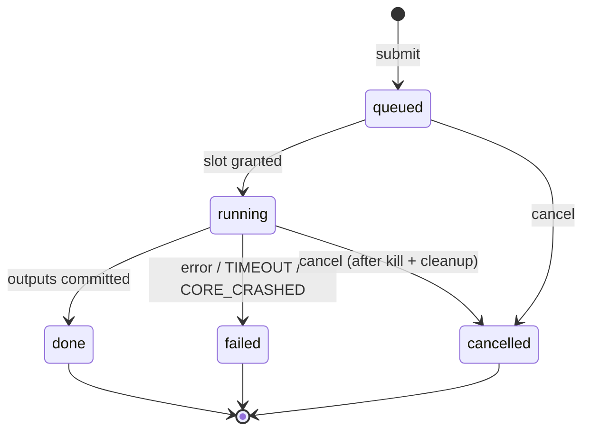

**File row** (renderer)

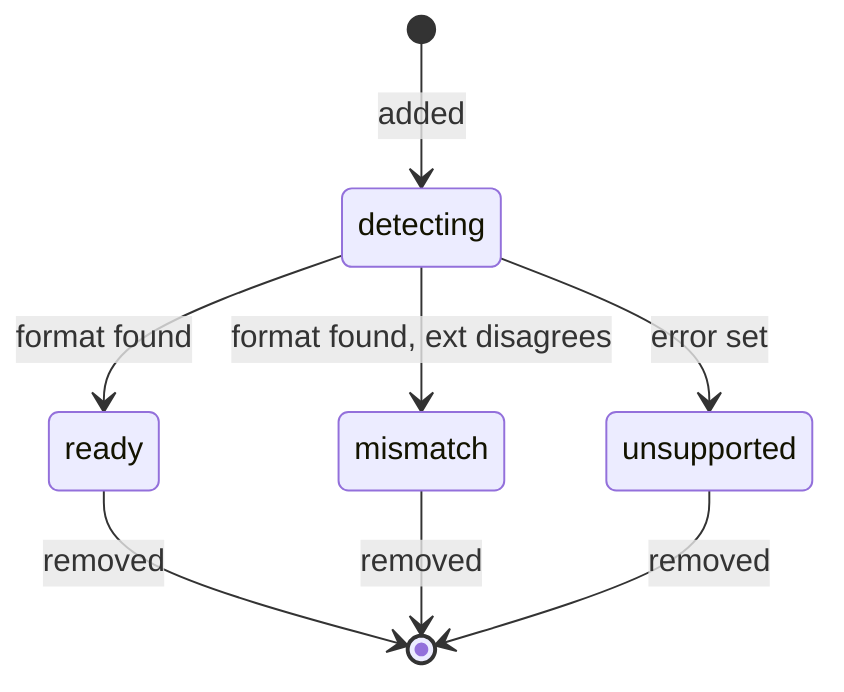

**Core host** (`CoreStatus`)

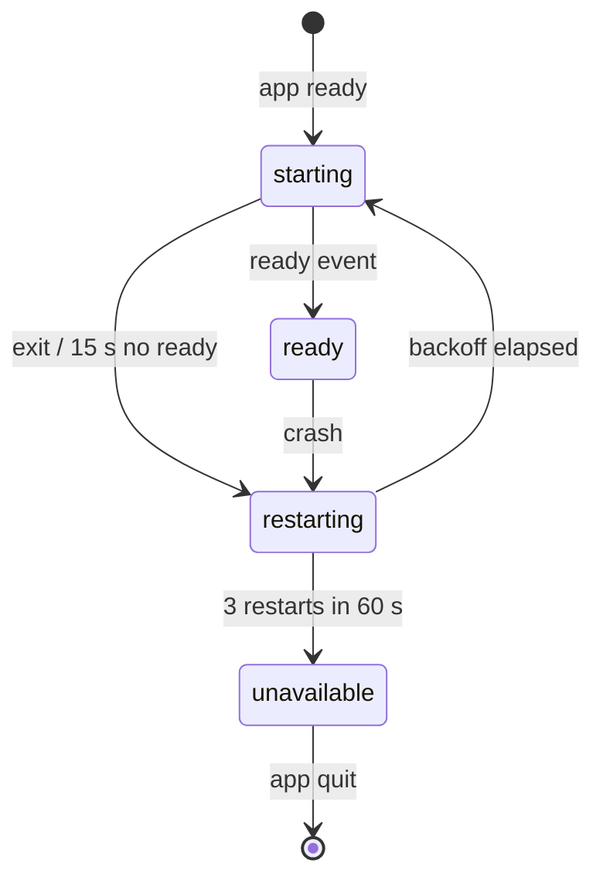

## F1. App startup

**Trigger:** the user launches the app.

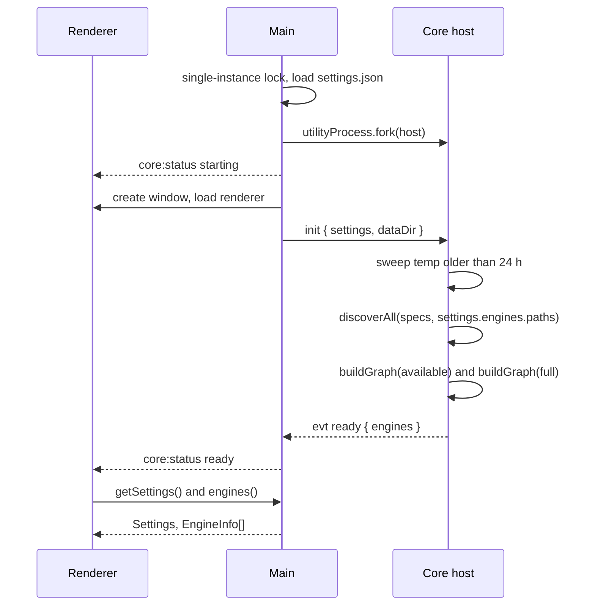

**Steps**
1. If a second instance starts, it focuses the existing window and forwards any file paths in argv. shortcut: argv paths are ignored in M1, until shell integration exists.
2. Settings load is validated. Invalid settings are renamed to `settings.bad.json` and the defaults are used ([CONTRACTS section 8](CONTRACTS.md#8-settings)).
3. The renderer may load before core is ready. Until `ready`, the UI shows the drop zone with "Starting…", and drops are queued in renderer state.

**Errors:** no `ready` within 15 s, or the host exits, leads to [F12](#f12-core-crash-and-recovery).
**Invariants:** no RPC method other than `init` is sent before `ready`.
**Tests:** `supervisor.test.ts` (fake fork: ready, timeout, exit), `server.test.ts` (`init` emits `ready`, and methods before `ready` give `CORE_UNAVAILABLE`).

## F2. Add files and detect

**Trigger:** a drop, "Choose files", or a folder drop.

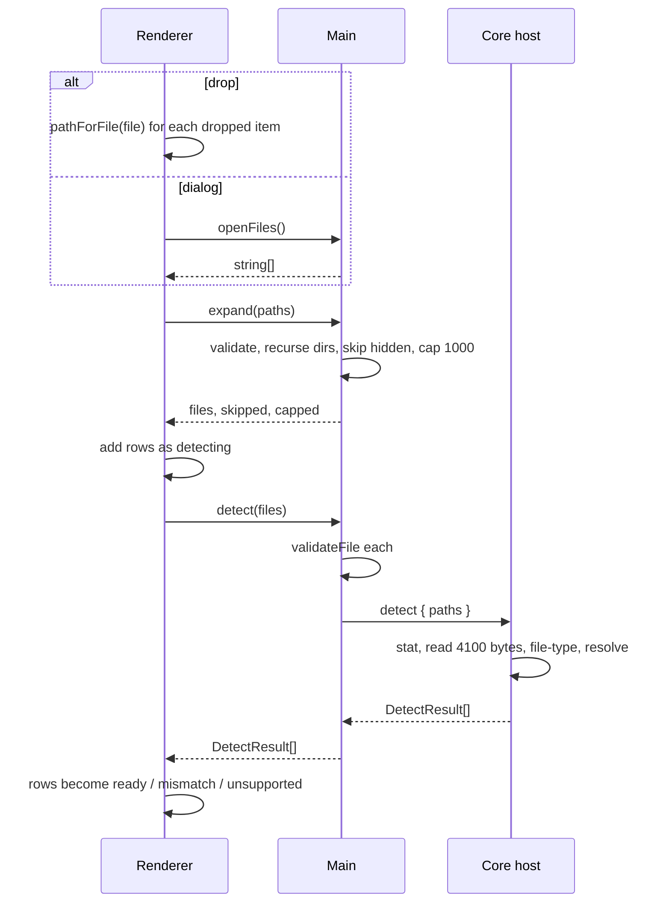

**Steps**
1. Duplicates (by real path) are ignored, with no new row.
2. `capped: true` shows a toast: "Added the first 1000 files".
3. Detection follows [ARCHITECTURE section 7](ARCHITECTURE.md#7-detection-algorithm).

**Errors:** a per-file `INPUT_NOT_FOUND`, `INPUT_UNREADABLE`, `EMPTY_FILE` or `UNSUPPORTED_FORMAT` marks that row unsupported, and the batch continues.
**Invariants:** the renderer never builds paths itself. Detection never opens a file for writing.
**Tests:** `paths.test.ts` (expand: recursion, hidden files, symlinked dirs, cap), `detect.test.ts` (renamed fixtures, OLE, zip, empty, svg sniff).

## F3. Target list

**Trigger:** the `files` slice changes (debounced 150 ms).

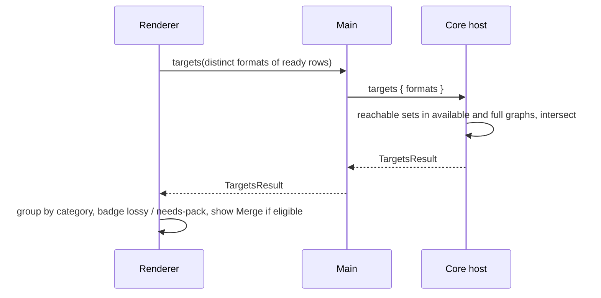

**Steps**
1. Unsupported rows are excluded from `formats`. If every row is unsupported, there's no call and the picker is disabled.
2. If the current `selection.target` isn't in the new result, it's cleared.
3. The Merge toggle shows when there are 2 or more ready rows and `merge` has an entry ([ARCHITECTURE section 8](ARCHITECTURE.md#8-routing-algorithm)).
4. The OptionsBar shows only the keys in the chosen `TargetOption.options`.

**Errors:** an empty `convert` shows "These files share no output format".
**Invariants:** a `ready` target always has a route in the available graph for every input.
**Tests:** `graph.test.ts` (intersection, needs-pack labelling, merge eligibility), `selectors.test.ts`.

## F4. Single convert

**Trigger:** Convert with one file, target jpg → png.

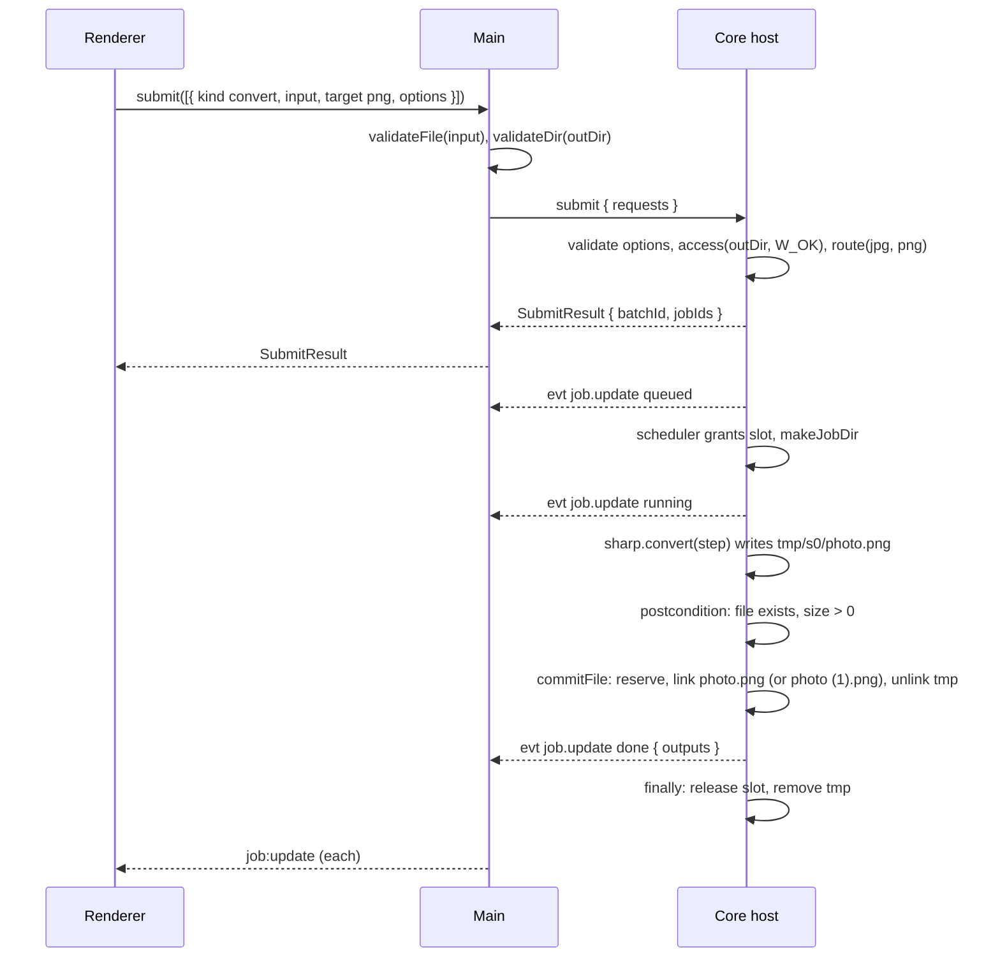

**Steps**
1. Commit follows [ARCHITECTURE section 10](ARCHITECTURE.md#10-output-commit).
2. "Show in folder" calls `reveal(outputs[0])`. Main only allows paths that appear in some job's `outputs`.

**Errors:** at submit, `INVALID_REQUEST`, `OUTPUT_DIR_NOT_WRITABLE` and `NO_ROUTE` reject the call and no job is created. During the run, see [F9](#f9-failure-and-retry).
**Invariants:** the source is never opened for writing. Nothing appears at the destination until the commit, and nothing partial ever appears there.
**Tests:** `runner.test.ts` (fake converter: happy path, update order), `output.test.ts` (conflict naming, reservation race between two concurrent commits, EXDEV fallback).

## F5. Multi-hop with fan-out

**Trigger:** convert `report.docx` → png. The route is docx →(libreoffice) pdf →(poppler, fanOut) png. Poppler arrives in M1.1, and its own details are in [F14](#f14-pdf-pages-to-images). This flow shows how a multi-hop fan-out chains together.

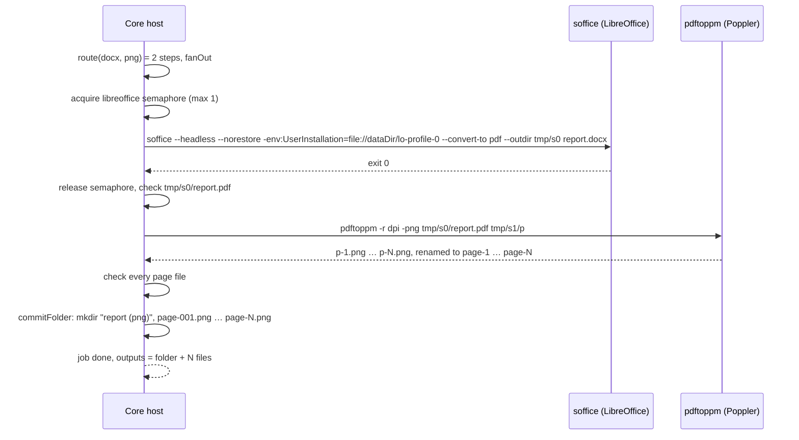

**Steps**
1. Progress: `total = 2` steps. During soffice `fraction = null` (indeterminate). During pdftoppm it's pages done / N.
2. A later step after a fan-out (e.g. png → webp) runs once per page, in order, into `tmp/s2/<n>/`.

**Errors:**
- soffice exits 0 without writing a pdf: `ENGINE_OUTPUT_MISSING`.
- soffice hangs: `TIMEOUT` (it's killed with its whole process tree).
- `mkdir` conflicts: the folder gets a `(n)` suffix.

**Invariants:** at most one fan-out per route, and the page order is preserved.
**Tests:** `graph.test.ts` (fan-out rule), `runner.test.ts` (fake fan-out converter feeding a mapped step), `libreoffice.test.ts` (golden, engine-gated).

## F6. Batch

**Trigger:** Convert with N files and one target, without merge.

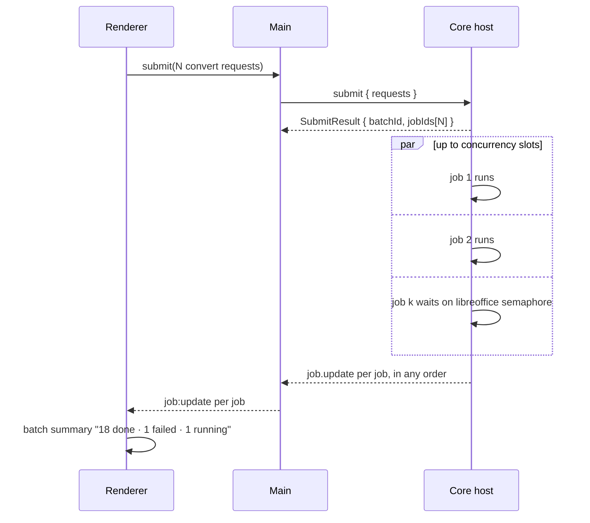

**Steps**
1. All requests are validated before any is queued. One invalid request rejects the whole call ([CONTRACTS section 6](CONTRACTS.md#6-core-rpc-protocol)).
2. Jobs start in FIFO order, but they can finish in any order.

**Errors:** a failed job never affects its siblings ([TRD FR-10](TRD.md#2-functional-requirements)).
**Invariants:** running jobs ≤ concurrency, and concurrent LibreOffice steps ≤ 1.
**Tests:** `scheduler.test.ts` (slots, semaphore, FIFO), `runner.test.ts` (batch with one failing fake).

## F7. Merge to PDF

**Trigger:** 2 or more files, target pdf, Merge ticked, rows reordered. The same flow runs "One long image" (`stack-png`, target png), which also accepts 1 file whose route fans out; a fanned-out input adds all its pages in order.

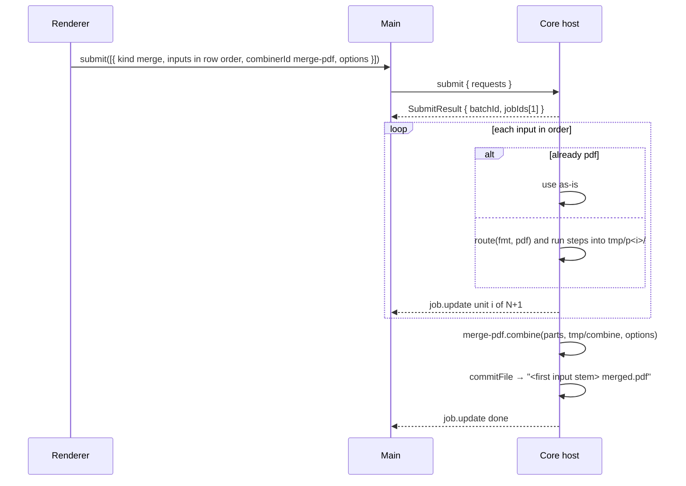

**Steps**
1. The output name is `<first input stem> merged.pdf` in the output dir, with the normal conflict rule.
2. `pageSize` applies to image inputs (pdf-lib img → page). Existing PDF pages keep their size.

**Errors:** any input fails, so the job fails with that input's error and `error.input` set, and no output is written. A missing route gives `NO_ROUTE` or `ENGINE_MISSING`, and is checked for every input before any step runs.
**Invariants:** the page order equals the user's row order.
**Tests:** `merge-pdf.test.ts` (golden: page count = sum, order checked via per-page size fixtures), `runner.test.ts` (one input failing aborts the merge).

## F8. Cancel

**Trigger:** Cancel on a job row, or quitting while jobs run.

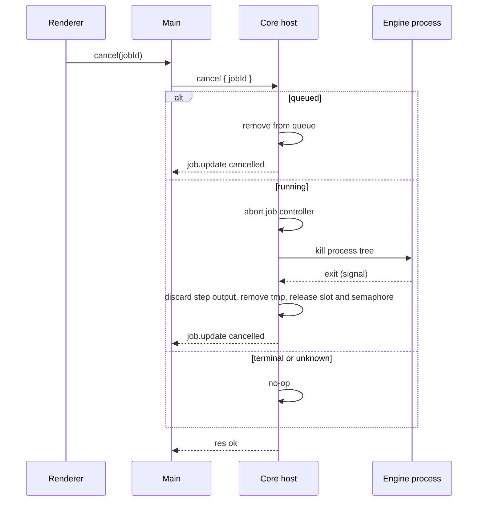

**Errors:** none surface to the user. A kill failure is logged and the job is still marked cancelled after cleanup.
**Invariants:** within 2 s of cancel there's no engine process left, no temp dir and no partial output ([PRD F8](PRD.md#5-features-by-milestone)). The `cancelled` state is only emitted after cleanup.
**Tests:** `spawn.test.ts` (abort kills a child that has its own child), `runner.test.ts` (cancel while queued, while running, and after done).

## F9. Failure and retry

**Trigger:** an engine exits non-zero, produces nothing, or exceeds its timeout.

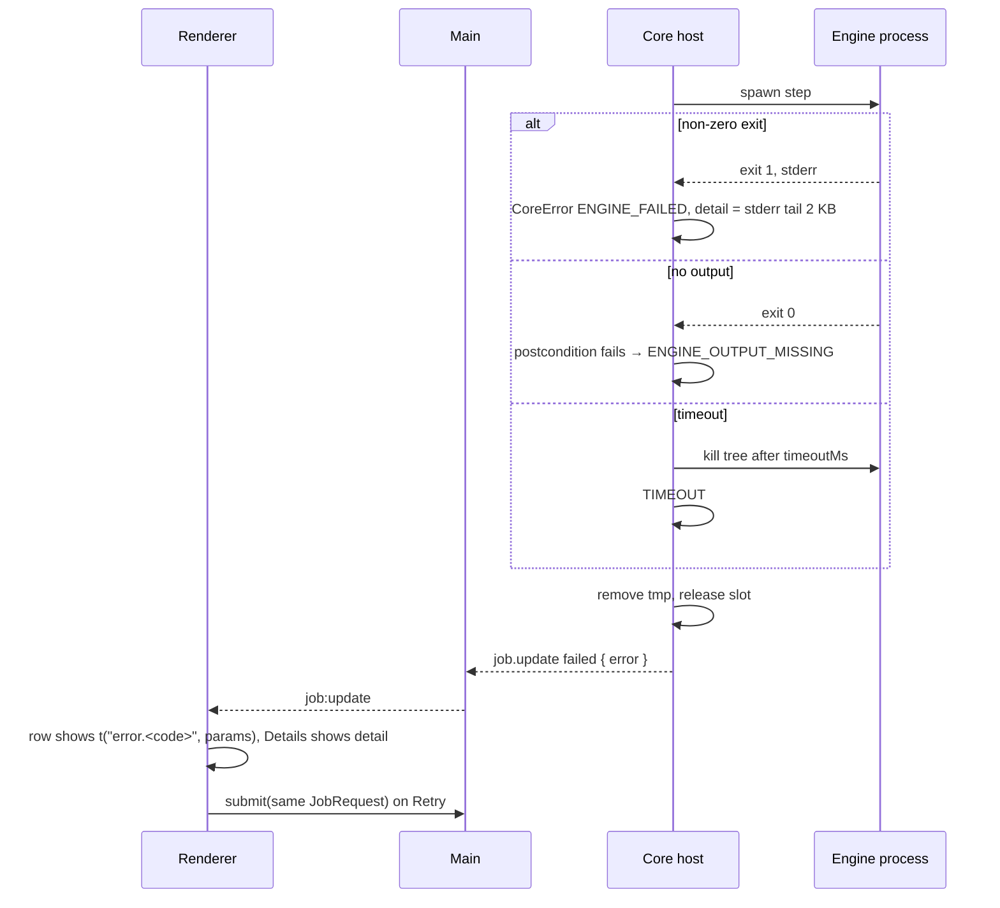

**Steps**
1. The row text is `t("error.<code>", params)`, using the English text in [CONTRACTS section 5](CONTRACTS.md#5-errors) as `en.json`. `detail` is shown raw, only under "Details".
2. Retry is offered only for retryable codes. It creates a **new** job, and the failed row stays in the list.
3. `ENOSPC` at any point gives `DISK_FULL`.

**Invariants:** a failed job leaves no temp dir and no partial output.
**Tests:** `runner.test.ts` (each failure kind via fakes), `spawn.test.ts` (stderr tail truncation, timeout).

## F10. Missing engine, then set path

**Trigger:** the user picks a target marked `needs-pack` (e.g. docx → pdf without LibreOffice).

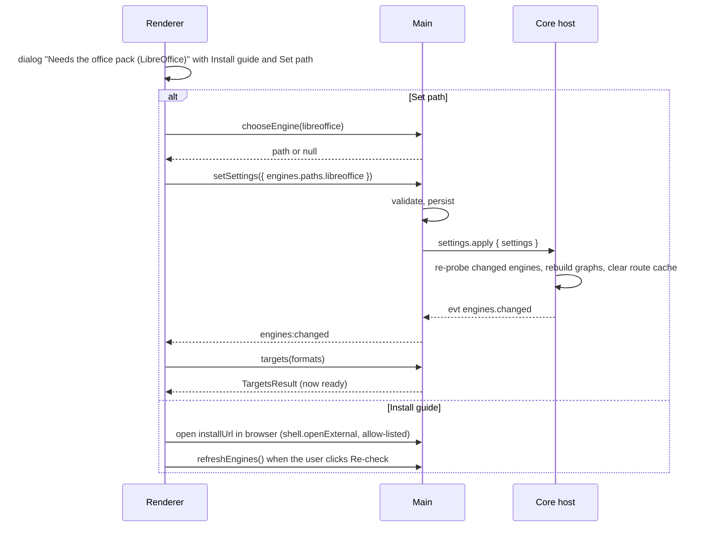

**Errors:** an invalid override path gives `EngineInfo.error` ("not executable"). The target stays `needs-pack` and the Engines page shows the error.
**Invariants:** the graph only contains converters whose engine is `found`.
**Tests:** `discovery.test.ts` (override invalid, PATH, known path glob, WSL `/mnt/c` skip, version probe failure), `server.test.ts` (`settings.apply` emits `engines.changed`).

## F11. Settings change

**Trigger:** the user edits Settings (output folder, concurrency, priority, theme, accent, language).

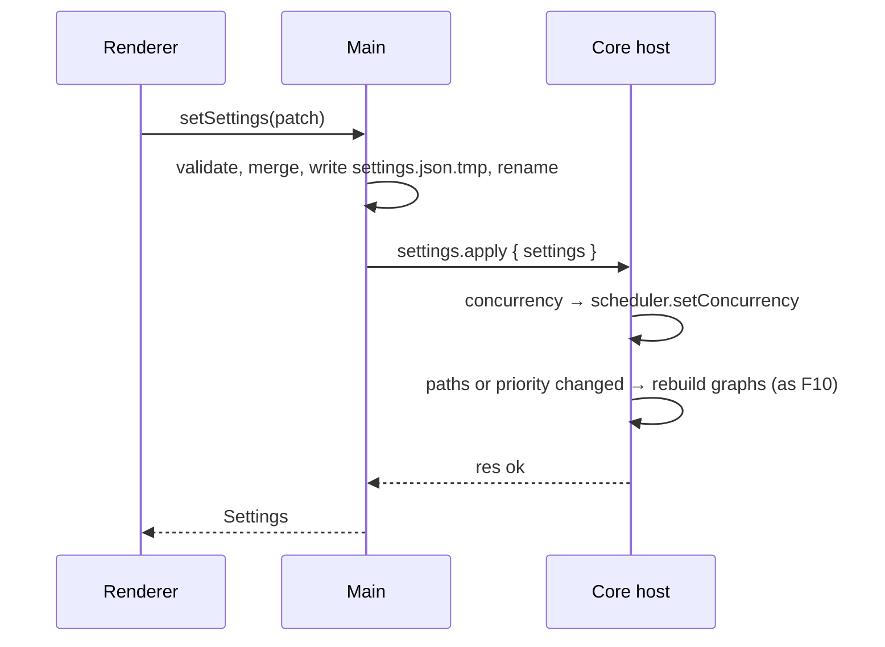

**Errors:** an invalid patch gives `INVALID_REQUEST`, and nothing is persisted.
**Invariants:** running jobs are never interrupted by a settings change. Theme, accent and language changes never reach core, and apply without a reload: the renderer updates `<html>` attributes and theme tokens, and re-renders text with the new locale.
**Tests:** `settings.test.ts` (validation, atomic write, bad file recovery), `scheduler.test.ts` (setConcurrency).

## F12. Core crash and recovery

**Trigger:** the core host exits unexpectedly (a native crash, out of memory) or misses `ready` within 15 s.

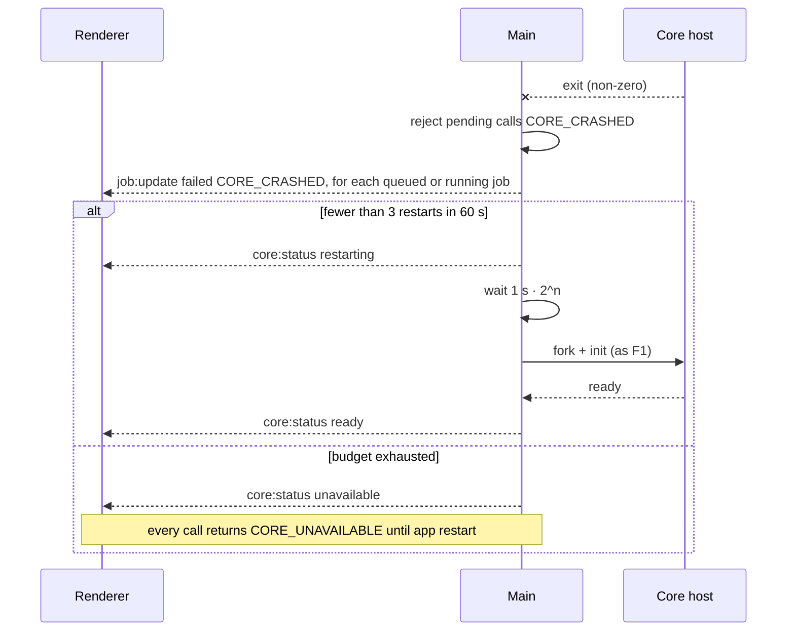

**Steps**
1. Main keeps the last known `Job` per id, from the relayed updates, so it can synthesize the failure updates.
2. Leftover temp dirs from the dead host are removed by the next host's `init` sweep, or by the 24 h rule.

**Invariants:** the renderer never freezes or crashes because core died.
**Tests:** `supervisor.test.ts` (fake fork: crash, then restart, then budget exhaustion, then synthesized updates).

## F13. App quit

**Trigger:** the window is closed or the app quits.

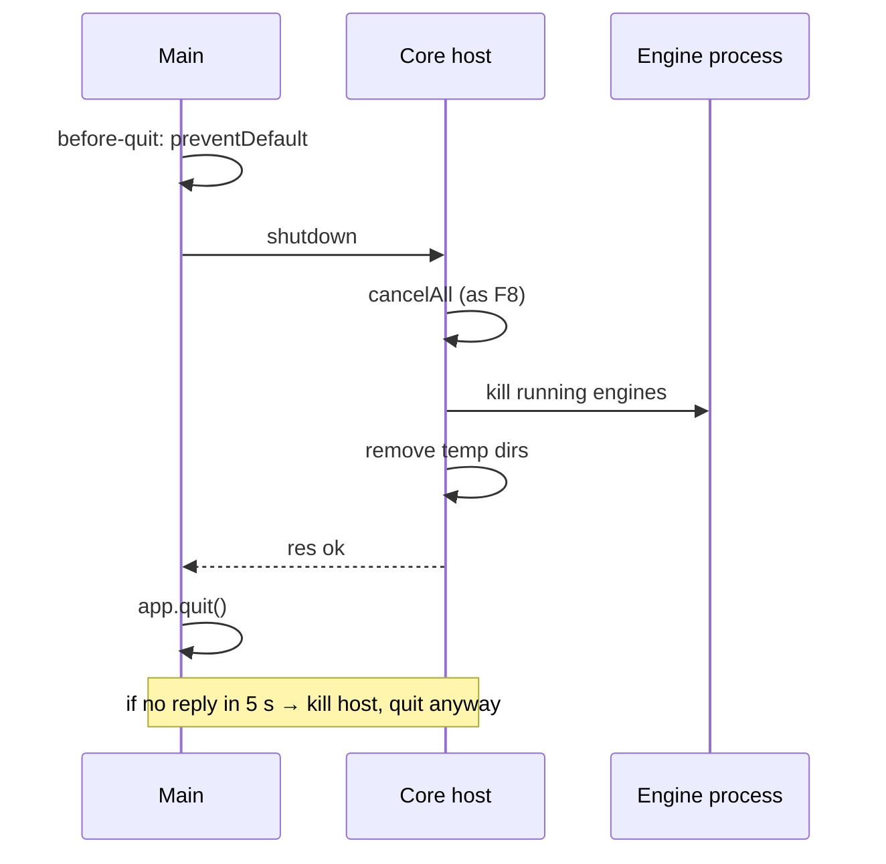

**Invariants:** after quit there are no orphan engine processes and no temp dirs from this session (best effort if killed).
**Tests:** `server.test.ts` (shutdown cancels and cleans up), manual smoke test per OS.

## F14. PDF pages to images

**Trigger:** a PDF row, target png, jpg or tiff, and optionally `pages` = `2-3,7` and `dpi` (M1.1).

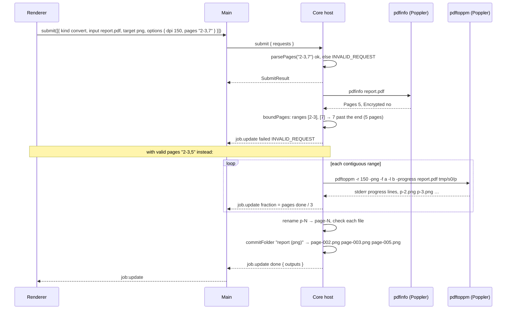

**Steps**
1. Without `pages`, the whole document renders in one `pdftoppm` call (`-f 1 -l N`).
2. jpg uses `-jpeg -jpegopt quality=<quality>`. tiff uses `-tiff`.
3. The row's "Open folder" reveals `outputs[0]`, which is the folder.

**Errors:** `INVALID_REQUEST` (bad syntax at submit, or out of range at run time), `INPUT_ENCRYPTED`, `ENGINE_FAILED` (a corrupt PDF), `TIMEOUT` (Poppler edges set `timeoutMs` to 600 s per range), `ENGINE_MISSING` (Poppler not installed, leading to [F16](#f16-install-an-engine)).
**Invariants:** file names use the real page numbers, and pages outside the range are never rendered.
**Tests:** `pages.test.ts` (grammar, merge, bounds), `poppler.test.ts` (golden and engine-gated: a 3-page fixture gives 3 files with page-numbered names and pixel width = page width in inches × dpi, plus a range subset).

## F15. Extract embedded images

**Trigger:** a PDF row, then **Extract images**, optionally with `pages` (M1.1).

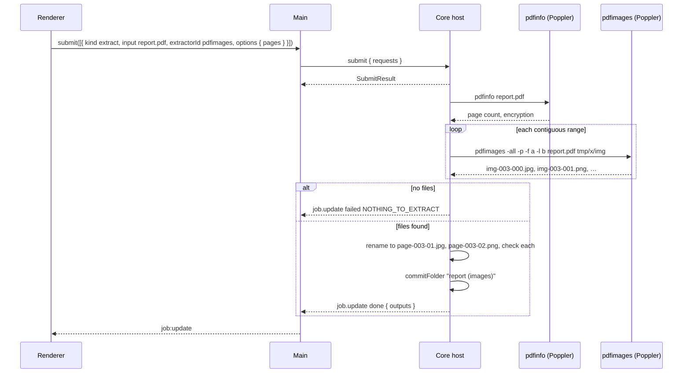

**Steps**
1. Extraction is **lossless**: each image is written in its stored format with no re-encode. Formats that can't be stored natively are written as png.
2. Progress is indeterminate (`fraction = null`), with `unit` advancing per range.
3. A PDF with many inputs selected shows "Extract images" only when **every** selected file is a PDF. That runs one extract job per file.
4. "Split into pages" (`split-pdf`, pdf-lib, M1.1-6) is a second extractor and runs the same flow, writing `page-<n>.pdf` into `report (pages)/`.

**Errors:** `NOTHING_TO_EXTRACT` (not retryable, shown as info rather than an error style), `INPUT_ENCRYPTED`, `INVALID_REQUEST` (pages), `ENGINE_FAILED`, `ENGINE_MISSING`.
**Invariants:** extracted bytes equal the embedded stream for natively stored formats.
**Tests:** `pdfimages.test.ts` (golden and engine-gated: a fixture PDF with 2 embedded JPEGs gives 2 files **byte-identical** to the original JPEGs, a text-only PDF gives `NOTHING_TO_EXTRACT`, and a page range limits the output), `runner.test.ts` (extract kind with a fake extractor).

## F16. Install an engine

**Trigger:** the user picks a `needs-pack` target or the Extract action, or clicks Install on the Engines page (M1.1, Poppler).

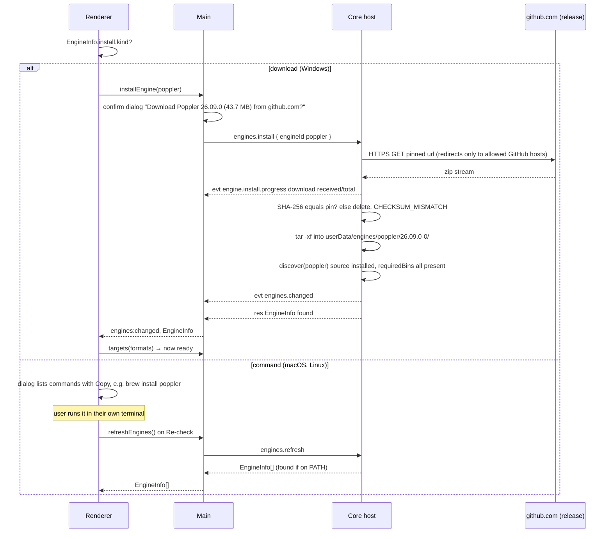

**Steps**
1. The confirm dialog shows the engine, version, size and source host. Declining rejects with `CANCELLED` and nothing is downloaded.
2. Installs run one at a time per engine. A second click while one runs returns the same pending result.
3. shortcut: there's no in-app uninstall. Delete `userData/engines/poppler/` by hand. Add a Remove button if users ask.

**Errors:** `INSTALL_FAILED` (network, unzip, or binaries missing after unpack, with the partial dir removed), `CHECKSUM_MISMATCH` (file deleted, never unpacked), `INVALID_REQUEST` (`engines.install` on a command-kind engine).
**Invariants:** nothing is unpacked or executed before the hash matches. The app never runs a package manager or `sudo`. No network access happens without that confirm dialog.
**Tests:** `install.test.ts` with a local HTTPS server and a self-signed cert passed via deps: happy path, checksum mismatch, a redirect to a non-allowed host refused, truncated download, a zip missing `pdfimages` → `INSTALL_FAILED`, cleanup in every failure. `discovery.test.ts` (installed source order, requiredBins).

